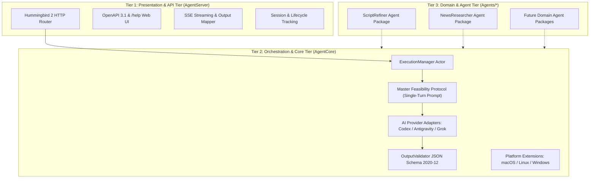

# Architecture and decisions

The repository keeps Xcode entry points at its root. The executable and reusable
library are the Swift package at `Packages/AgentServer`. Development guidance is in
`Packages/AgentServer/AGENTS.md`; public documentation is in `Documentation`.

## Three-Tier Architecture

The system is structured as a modular, decoupled **Three-Tier Architecture**:

### 1. Presentation & API Tier (`AgentServer`)
- **Composition Root & Web Server**: Powered by Hummingbird 2, providing loopback-bound HTTP routing for `/agents`, `/execute`, `/status`, `/openapi.json`, and `/logs`.
- **Contract & SSE Transport**: Decouples transport from agent execution. Supports synchronous single-value responses (HTTP 200 / 422 / 400 / 404 / 500) and opt-in SSE streaming (`status=true`).
- **Direct Error Pass-Through**: When the agent returns a feasibility error dictionary, `AgentServer` sets the response status code to **HTTP 422 Unprocessable Entity** and passes the raw agent error dictionary directly to the client without alteration.
- **Web Reference & Diagnostic UI**: Serves interactive documentation, Try It console, and session log inspection via `AgentResources`.

### 2. Orchestration & Core Tier (`AgentCore`)
- **Execution Lifecycle & Concurrency**: Actor-isolated `ExecutionManager` enforces process concurrency limits (budget of 8), burst queueing, timeouts, and graceful shutdown draining.
- **Master Feasibility Protocol**: Injects a generic, single-turn feasibility verification instruction into all provider prompts (`CLIProviders.swift`), requiring the model to return `{ "error": { "reason": "..." } }` if the client input is meaningless or unfeasible.
- **Provider Adapters**: Common abstractions for CLI AI engines (Codex, Antigravity, Grok) with isolated process I/O, output streaming, and unified error handling.
- **Strict Schema Validation**: Bounded JSON Schema (Draft 2020-12) engine (`OutputValidator.swift`) validates domain output before reporting successful completion.
- **Cross-Platform Abstractions**: Formal platform contracts (`PlatformContracts.swift`) fulfilled by operating-system extensions for macOS (Mach/Darwin), Linux (Glibc/procfs), and Windows (Win32/PSAPI).

### 3. Domain & Agent Tier (`Agents/*`)
- **Independent Swift Packages**: Standalone libraries (e.g. `ScriptRefiner`, `NewsResearcher`) conforming to `AgentPackageContract`.
- **Pure Domain Specifications**: Pure, immutable version directories containing `role.md`, `instructions.md`, optional `input.schema.json`, and `output.schema.json`.
- **Zero Framework Pollution**: Agent packages contain no server or transport logic, allowing them to remain portable and clean.

## Boundaries

`AgentServer` is the composition root, HTTP contract mapping and SSE transport.
`AgentCore` owns typed configuration, JSON models, semantic versions, registry,
provider contracts/adapters, process lifecycle, actor-owned execution management,
validation and Swift package tooling. It does not import Hummingbird.

`AgentResources` packages default configuration and web pages.
Each agent is an independent SPM library under `Agents/AgentID` conforming to `AgentPackageContract`.
Agent availability requires explicit Swift registration in `AgentRegistry.registeredPackages`.
The build enforces validation of schemas, contracts, resources, and examples, and generates package README
and embedded metadata. Checked-in agent READMEs use the same generator through
`AgentTools docs`; `AgentTools docs --check` detects drift before PRs and releases.
Builds do not rewrite source documentation. At startup, the server verifies packaged
validation metadata and rejects unvalidated or changed resources.

## Operational decisions

- Hummingbird 2; final JSON responses by default, optional `status=true` SSE; Swift 6, macOS 14+; loopback only.
- Central JSON settings, default port 8080, 900-second shutdown allowance.
- Kernel-owned per-user/per-port instance locks identify managed previous servers;
  stale PID files cannot accidentally target unrelated processes.
- Startup requests SIGTERM and waits for lock release before replacing a managed server.
- Accepted work drains on graceful shutdown; new work is rejected. Deadline-expired
  work is cancelled and its process is reaped before releasing resources.
- Default process budget is eight, with a bounded burst queue. Provider memory is
  monitored, and process growth pauses at its budget. HTTP connections and active
  provider work are separate; disconnected clients do not cancel executions.
- Bounded event/result buffers and terminal state retention protect memory. Slow or
  disconnected stream consumers detach while their execution continues.
- Exact agent versions are snapshotted and cached as immutable definitions; source
  modifications to a loaded version are ignored until restart. Publish a new version.
- No database, distributed queue, recovery after restart or resumable stream.

## Provider contracts

Adapters handle configured executable resolution, local readiness, input formatting,
stdout/stderr, provider events, final results and scoped termination. They inherit the
normal user environment and cached CLI login. No arbitrary shell command is accepted
through the HTTP API; inputs become JSON prompt data, not shell syntax.

Codex uses read-only exec and native structured output. Antigravity uses sandboxed
headless stream-json and its structured result; known tool transport annotations are
separated without accepting arbitrary extra result fields. Grok uses headless streaming
messages and server-side validation. Provider safeguards remain enabled.

## Validation

The validator implements a documented bounded subset of Draft 2020-12 assertions,
including objects/arrays/strings/numbers, enum/const, local references and compositions.
Unsupported assertions or malformed schemas make definitions unavailable. It is not
a complete implementation of every Draft 2020-12 vocabulary. This explicit rejection
avoids reporting success while silently skipping a constraint.

POST /execute returns one validated final JSON value or structured error by default.
The optional status=true query parameter enables lifecycle/progress SSE and one result
followed by completed. Raw provider output stays internal in both modes.
Only parsed, validated final output emits result and completed. Intermediate provider
text is provisional. Provider failures, malformed JSON and schema mismatches emit
structured failed events. Status records contain operational metadata, not input/prompts.

## Tests and remaining verification

Deterministic Swift tests cover package creation, registry discovery and versions,
immutable snapshots, schema assertions, synthetic Codex/Antigravity/Grok frames,
process I/O, execution success/failure, cancellation, disconnect policy, concurrency,
burst queueing and HTTP contracts. Actual provider login/backend readiness and live
socket behavior need the separate integration run described in RUN.md.

Do not mark every Version 1 acceptance criterion verified merely because mock tests
pass. Live CLI behavior and resource-pressure behavior must be evaluated on the target
Mac with the user's configured providers.

## Platform portability

Core business logic (`ProcessRunner`, `SystemResources`, `ServerInstance`, `CLIProviders`) remains common and platform-agnostic in `Sources/AgentCore`. Low-level operating system hooks are specified by formal protocol contracts (`Protocols/PlatformContracts.swift`) and fulfilled strictly via extensions in dedicated platform directories:
- `Platform/macOS/`: Darwin `F_SETNOSIGPIPE`, Mach `proc_pidinfo` and `host_statistics64`, POSIX process groups, and `fcntl` instance locking.
- `Platform/Linux/`: Glibc, `/proc/<pid>/statm`, `/proc/meminfo`, `SIGPIPE` ignore, and `/proc/<pid>/exe` link inspection.
- `Platform/Windows/`: WinSDK, PSAPI `GetProcessMemoryInfo`, `GlobalMemoryStatusEx`, Win32 Named Mutexes/Events, and `;` PATH delimiter.

## Session diagnostics

Failed terminal tracking records retain bounded error code/message alongside ID,
state and timing. Execution resources are still released and shutdown purges all
in-memory records. ExecutionSessionLog appends compact JSONL state transitions to
a per-port temporary file, reset only after the server acquires its instance lock
on a fresh start. The Help-linked `/logs` viewer uses a bounded 200-entry tail;
`/execution-logs/download` streams a fixed full-file snapshot in chunks. Inputs,
results and provider output are excluded from the log.

## Provider reuse and restart ownership

ExecutionManager owns a value-state global LRU pool (default five retained
workers), with reservations before process launch and termination before
replacement. Busy workers cannot be evicted. Temporary burst workers and retiring
workers count toward the total process budget; pool memory includes retained idle
workers. Resource pressure can reclaim idle workers. Reset is confirmed before
publishing a successful result or returning a worker to the idle pool.

Native contexts are request-specific. Codex app-server request threads are deleted
and checked as unloaded; Grok owned no-leader stdio sessions require an advertised
and successful close operation. Unsupported setup before inference falls back to
fresh execution. Generation/reset failures are never replayed; reset failures
block further reuse for that provider for the session. Antigravity and unverified
Grok settings stay fresh. Provider settings/model are immutable for a server
session; pool keys additionally include provider, agent and version.

The private per-port ownership manifest captures child and owner PID/start/exe/UID
identities at launch. Startup cleanup follows acquisition of the instance lock and
re-verifies worker identity and absence of its original live owner before sending
signals. Unknown/PID-reused/live-owner processes are preserved. No watchdog is
created; SIGKILL cleanup is deferred until restart. Platform identity hooks fail
closed when verification is unavailable.

Codex native strict output schemas represent optional domain fields as required
nullable transport fields. The adapter removes only transport-added optional nulls
before authoritative validation against the unchanged domain schema; originally
nullable, required and unknown fields are preserved. Unsupported native shapes
use prompt-based JSON with the same authoritative server validation.
